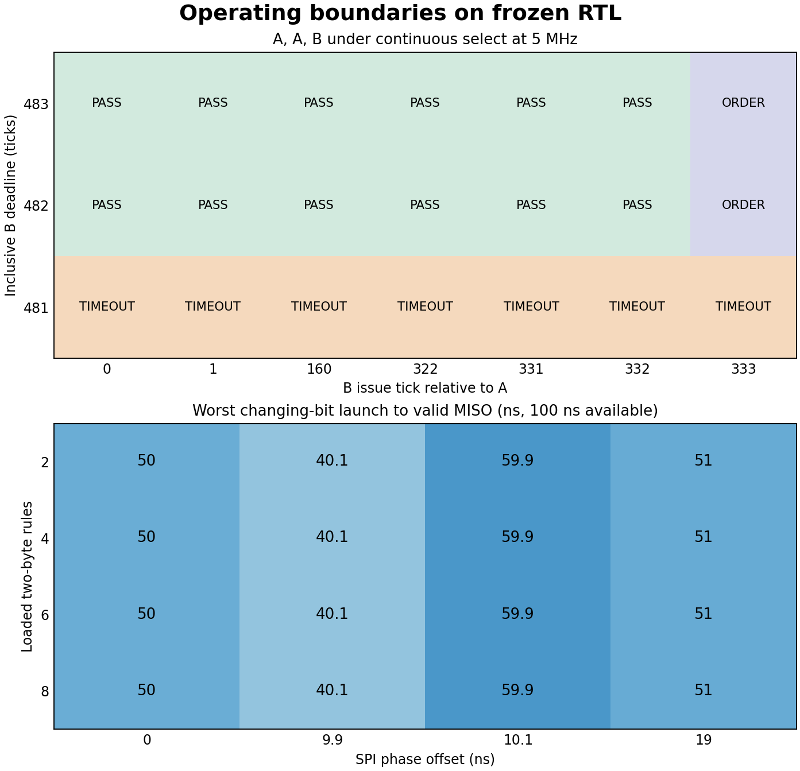

# Experiment C — Frozen SPI emulator operating boundaries

The experiment uses fixed synthetic SPI traffic and the Icarus model of commit `6fd555b7e008227d7bcdaa2b921525284ff5e062`. The system clock is 50 MHz (20 ns). The serial clock is 5 MHz (100 ns between launch and sample). A tick is the checker’s system-clock index from trial start. Timing values describe this digital simulation.

## Results

All five framing cases returned the three expected logical records and replies, including three consecutive records under one assertion of CS. Each case reported PASS at tick 601 after the inclusive 600-tick observation window. Across the four encodable branch depths, all 128 phase, mode and path combinations delivered A5 in the intended byte with 40.1 ns or more setup. The first capacity failure was the ninth rule. The requirement to send A5 on the tenth byte produced 00 because the final literal fell outside the loaded image.



Of the 21 issue/deadline combinations, 12 returned PASS, seven TIMEOUT and two ORDER. With A and B both issued at tick zero, both quotas completed when B's deadline was at least 482. Shortening that deadline from 482 to 481 made the same traffic late. Moving B’s issue from 332 to 333 made its first sample ineligible, even with a deadline of 483. If both constraints were violated the checker reported TIMEOUT at tick 482. Every terminal failure identified source B and preserved A’s two accepted records. All checker responses matched the independent schedule oracle.

| Measured interval | Observations | RTL time | 50 MHz cycles |
| --- | ---: | ---: | ---: |
| L1, launch edge to first output bit of A5 | 128 first bits | 40.1–59.9 ns | 2.005–2.995 |
| L1, launch edge to any changing bit of A5, including first bits | 896 toggles | 40.1–59.9 ns | 2.005–2.995 |
| Remaining setup before the 5 MHz sample | 896 toggles | 40.1–59.9 ns | 2.005–2.995 |
| L2, external closing sample of incorrect command to registered WRONG on the verdict page | 1 trial, mode 0 | 50 ns | 2.5 |
| L2, final admissible clock edge to registered TIMEOUT on the verdict page | 1 trial | 20 ns | 1 |
| L3, registered TIMEOUT to effective profile 1 and archive count increment | 1 transition | 20 ns | 1 |
| L3, same TIMEOUT to acceptance of the next trial, visible as a cleared verdict | 1 transition | 40 ns | 2 |
| L3, same TIMEOUT to the next profile’s A notification | 1 transition | 60 ns | 3 |

The 2-, 4-, 6- and 8-rule programs have the same measured maximum launch time at each tested phase. Additional comparisons consume full wire bytes before the literal instruction can schedule its reply. The two-rule fall-through program emits A5 on byte 3; the eight-rule program emits it on byte 9, six bytes or 9.6 µs later at 5 MHz. Each still meets the launch deadline within its designated reply byte. Phase coverage here samples four offsets. The [frozen release’s independent operand-edit measurement](../docs/P5_PHYSICAL_ACCEPTANCE.md) reports 40.1–60.0 ns over 22 offsets and all four modes with active feedback and history-dependent MISO data.

L2’s mismatch interval includes synchronization of the external clock edge. For the timeout interval the first clock on which expiry establishes a verdict is deadline + 1. The reported one-cycle interval starts at the preceding, final admissible edge. The L3 probe checked the working profile register in RTL and observed the archive count, cleared verdict and IRQ on pins. L2 and L3 each cover the listed endpoints and cases. Additional checker decisions, feedback rules and operating conditions would require separate timing coverage.

Two isolated runs produced identical 160-row CSVs (SHA-256 `74f3901ac7d06900745b9a49e9002bf0f9d38090d21de99ed0cee40d7eb5e533`). Each run includes 5 framing rows, 21 overlap rows, 128 encodable complexity rows, 1 out-of-capacity row, 2 checking rows and 3 feedback rows. The nine expected overlap violations and the unrepresentable image are retained in the CSV. The formal runs used Icarus 12.0 and Cocotb 2.0.1. A presentation-only correction removed overlapping plot titles after rendering.

## Test design

| Sweep | Loaded program and external checks |
| --- | --- |
| CS framing | A two-rule stream program tags the address and closes each record after its second byte. The peer sends the same six MOSI bytes and expects the same six MISO bytes for three logical records, A, A, B. Group sizes per CS assertion are 3, 2+1 and 1+1+1. Multiple windows have 100 or 500 ns deselection. Checker quotas are 2 and 1, with lengths, identities, command, address, reply data and order checked. |
| Event overlap | With CS held low, A issues at tick 0 and B issues at 0, 1, 160, 322, 331, 332 or 333. A’s two-record quota closes at its deadline of 322. B’s first synchronized sample is 332 and its closing sample is 482. Each B issue is crossed with deadlines 481, 482 and 483. The peer reads terminal verdict, source mask, stamp and counts, and records IRQ changes. |
| Program complexity | Four images occupy 2, 4, 6 or 8 rules. Each comparison checks a distinct byte and restarts at state 0 on a match. A mismatch advances to the next comparison. After 1, 3, 5 or 7 comparisons the final literal instruction schedules A5 on the next byte. Each image takes a full fall-through path and a second path that restarts on its last comparison. Both paths cross modes 0–3 with phases 0, 9.9, 10.1 and 19 ns. The resolved pad must match every expected bit, including the first bit of A5. |
| Capacity | Submit a fifth, 18-byte image to the same loader. Its eight comparisons would require a ninth instruction to emit A5. Observe the tenth MISO byte after eight mismatches and a dummy byte. |
| Checking and feedback | A one-byte command mismatch at the end of a marked two-byte record produces WRONG. A separate two-trial campaign lets a fixed synthetic service window expire. A loaded TIMEOUT rule selects profile 1, whose A event is scheduled at tick zero. |

Phase is the additional delay after a fixed 40 ns lead-in from the start of the 20 ns core clock waveform. Its rising edge is at phase 10 ns. The frozen pin monitor checks the complete response, at least 20 ns of setup and 10 ns of hold at each sample. Its per-transition L1 measurement starts at the external launch edge and ends at the last transition to the correct resolved MISO level before sampling. The first A5 bit rises from the preceding zero and is directly measurable on every complexity path. Unchanged bits contribute to correctness and stability checks.

## Resource limits

| Resource | Frozen capacity | Use in this experiment |
| --- | --- | --- |
| SPI rule storage | Eight 16-bit rules in the shared 16-byte instruction store, three-bit branch target, six annotation bits per rule | Two annotated rules for framing and timing overlap. The four complexity images occupy 4, 8, 12 and 16 bytes. The capacity probe submits 18 bytes. |
| SPI model memory | Four 8-bit status entries with per-entry masks and seen bits, four shared state bits and two writable bytes | STREAM reads configured status data. Complexity chains exercise serial byte state and branch depth. |
| Event checker | Two event descriptors, independently timed, one to four records per source; a single open stream record | A and B quotas of two and one. A and B can be simultaneously outstanding. Records share one SPI wire and execute serially. |
| Feedback | Four policy rules, four parameter profiles, four stored trial records, two previous verdicts; two writable 8-bit operands | One rule, two profiles and two trials for the new L3 probe. The archived operand test also exercises a four-rule match. |
| Whole design area and timing | Frozen release reports 10,246 mapped cells, 155,696.310 µm² mapped area, 191,515 µm² pre-filler routed cell area, 15.8517% core utilization, +1.788/+0.104 ns setup/hold slack | All sweeps load the same hardware. Area is a release figure for the full macro. Per-program logic area and new place-and-route measurements are outside this experiment. |

Capacity and implementation figures come from the [byte-program and trial interface](../docs/info.md), [program storage RTL](../src/protocol_engine.v), [SPI target](../src/spi_target.v), [feedback policy](../src/feedback_policy.v) and [frozen physical release](../docs/P5_PHYSICAL_ACCEPTANCE.md).

## Supplementary study of history across CS windows

This 24-row study was added after preregistration. Both grant programs and their assembler come from the same RTL freeze. The peer sends zero, one or two affirmative A writes, each under its own CS assertion, followed by two identical B polls. An independent monitor decodes the fifth B reply byte directly from resolved CS, SCLK and MISO pin transitions. Each history is repeated in modes 0–3 at 5 MHz, at the 10.1 ns offset. Outputs below are hexadecimal.

| Affirmative A writes | First B reply, grant_one | First B reply, grant_two | Second B reply, both programs |
| ---: | --- | --- | --- |
| 0 | 00 | 00 | 00 |
| 1 | A5 | 00 | 00 |
| 2 | A5 | A5 | 00 |

Both programs occupy all eight rules and shift A’s vote into the same four-bit persistent register. Their predicate masks select the most recent bit or the most recent two bits. One prior affirmative write therefore produces different MISO data on the same B poll. Completion of that poll clears the register. All four SPI modes gave the displayed bytes. Across the 12 A5 replies, all 84 changing payload bits settled 59.9 ns (2.995 clocks) after launch, with 40.1 ns of setup. Constant 00 replies have a verified sampled level and no payload transition to time. These observations are tabulated separately from the 160 preregistered rows.

With the environment below active, run `python research/history_probe.py` to rebuild the programs and repeat the probe. [Supplementary source](history_probe.py) · [Supplementary raw CSV](results/boundary/history.csv) · [One-vote program](../examples/grant_one.p1) · [Two-vote program](../examples/grant_two.p1)

## Reproduce

On Linux or WSL, use Git, GNU Make and Icarus Verilog 12.0. From the repository root, with a Python 3.11 virtual environment active, run

```sh
python -m pip install cocotb==2.0.1 matplotlib==3.10.3
python research/run_boundary.py --out research/results/boundary
```

The runner exports the frozen source files and public test helpers into a new temporary directory. It compiles the RTL, runs the matrix, checks the Cocotb result XML, writes the [case-level CSV](results/boundary/cases.csv) and renders the [boundary plot](results/boundary/boundary.png). A development subset can be selected with `--smoke --out /tmp/boundary-smoke`. The CSV records every eligible transition delay for each transfer in picoseconds. MOSI and MISO byte strings are hexadecimal, and the MISO strings contain the values checked against the pad on every sampled bit. IRQ transitions are tick/mask pairs, with bit 0 for A and bit 1 for B.
