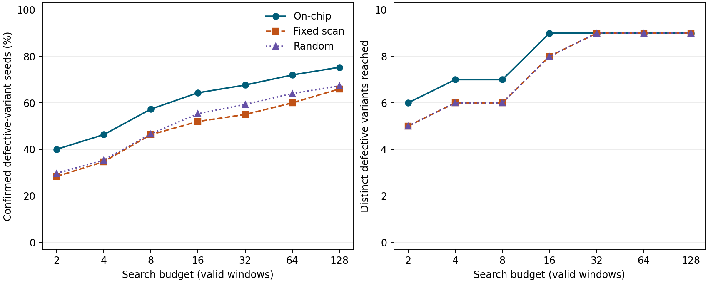
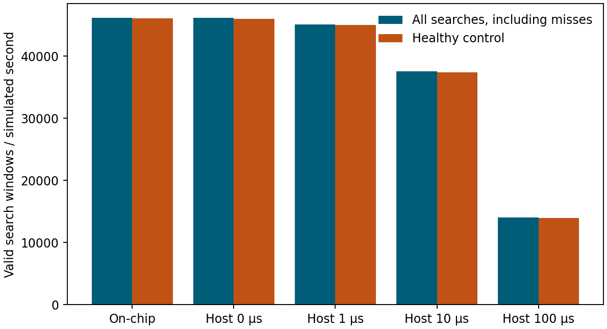
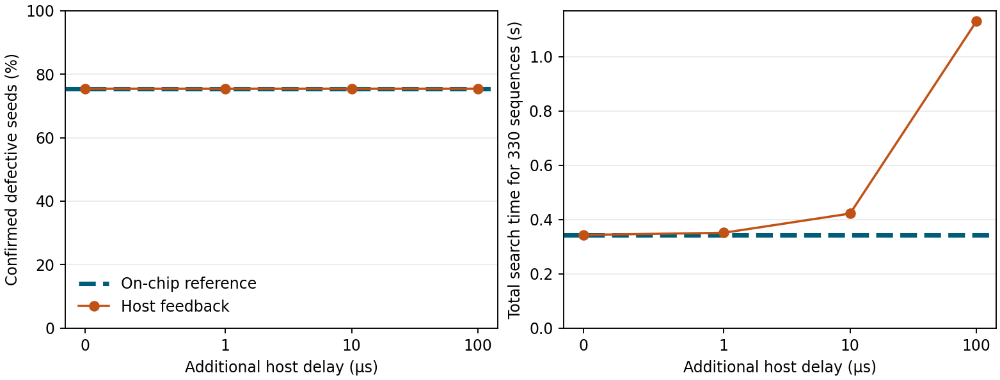

# Discovery and feedback placement on the frozen internal controller panel

Experiments A and B use ten defective controller models and one healthy control, each with 30 paired seeds. Each method receives up to 128 valid search windows per seed and variant. Credit requires a matching wire violation and P4 record, three fresh-block confirmations, and peer-free timed replay. These are synthetic digital simulations at a 50 MHz system clock. [Preregistered design](../docs/RESEARCH_EVALUATION_PLAN.md) · [Panel audit](PANEL_AUDIT.md) · [Experiment C, operating boundaries and capacity](BOUNDARY.md)

## A. Confirmed discovery by search budget

Each entry gives confirmed seeds out of 300, the mean per-variant confirmation percentage, and distinct variants reached out of ten. Each variant receives equal weight. The 30 healthy searches per method are scored separately. Reusing the same sequence prefixes at each budget preserves pairing. Confirmation and playback work is additional to the search budget.

| Windows | On-chip | Fixed scan | Random |
| --- | --- | --- | --- |
| 2 | 120/300 (40.0%), 6/10 | 85/300 (28.3%), 5/10 | 89/300 (29.7%), 5/10 |
| 4 | 139/300 (46.3%), 7/10 | 104/300 (34.7%), 6/10 | 106/300 (35.3%), 6/10 |
| 8 | 172/300 (57.3%), 7/10 | 139/300 (46.3%), 6/10 | 140/300 (46.7%), 6/10 |
| 16 | 193/300 (64.3%), 9/10 | 156/300 (52.0%), 8/10 | 166/300 (55.3%), 8/10 |
| 32 | 203/300 (67.7%), 9/10 | 165/300 (55.0%), 9/10 | 178/300 (59.3%), 9/10 |
| 64 | 216/300 (72.0%), 9/10 | 180/300 (60.0%), 9/10 | 192/300 (64.0%), 9/10 |
| 128 | 226/300 (75.3%), 9/10 | 198/300 (66.0%), 9/10 | 202/300 (67.3%), 9/10 |



The fixed scan was selected on the public development set. At 2, 4 and 8 windows the linear scan confirmed 0, 0 and 0 of 90 defective seeds, the modular scan confirmed 0, 0 and 30, and the selected scan confirmed 30, 60 and 90. Its second-window sequence starts with 0xA3, 0x59 and 0xCE, then the remaining byte values in increasing order. [Development scores](development.json) · [Frozen strategies](experiment.py)

### Paired effects and uncertainty

Positive differences favor on-chip feedback. Each paired comparison uses the same variant and seed. The interval gives the 2.5th and 97.5th percentiles from 20,000 paired bootstrap resamples of ten whole variants, retaining all 30 seeds of each sampled variant. It describes sensitivity to panel composition. The internally authored variants do not constitute a probability sample of production controllers.

| Windows | Comparator | Chip only | Comparator only | Difference (percentage points) | Variant bootstrap interval (pp) |
| --- | --- | --- | --- | --- | --- |
| 2 | Fixed scan | 35 | 0 | +11.7 | [+0.0, +31.7] |
| 2 | Random | 35 | 4 | +10.3 | [+0.0, +30.3] |
| 4 | Fixed scan | 37 | 2 | +11.7 | [+0.0, +32.0] |
| 4 | Random | 39 | 6 | +11.0 | [+0.0, +31.3] |
| 8 | Fixed scan | 36 | 3 | +11.0 | [-0.7, +31.3] |
| 8 | Random | 36 | 4 | +10.7 | [+0.0, +30.7] |
| 16 | Fixed scan | 41 | 4 | +12.3 | [-1.7, +33.3] |
| 16 | Random | 34 | 7 | +9.0 | [-2.3, +29.7] |
| 32 | Fixed scan | 42 | 4 | +12.7 | [-0.7, +32.7] |
| 32 | Random | 35 | 10 | +8.3 | [-4.7, +29.3] |
| 64 | Fixed scan | 44 | 8 | +12.0 | [-1.7, +31.3] |
| 64 | Random | 33 | 9 | +8.0 | [-2.0, +26.0] |
| 128 | Fixed scan | 38 | 10 | +9.3 | [-1.7, +27.0] |
| 128 | Random | 32 | 8 | +8.0 | [+0.0, +22.7] |

### Which variants the methods reached

Confirmed seeds out of 30 at 128 windows. The downloadable table includes every method, variant and budget.

| Variant | On-chip | Fixed scan | Random |
| --- | --- | --- | --- |
| c-27 | 30 | 26 | 30 |
| c-32 | 30 | 5 | 8 |
| c-4c | 5 | 8 | 4 |
| c-50 | 11 | 9 | 10 |
| c-6b | 0 | 0 | 0 |
| c-78 | 30 | 30 | 30 |
| c-95 | 30 | 30 | 30 |
| c-ad | 30 | 30 | 30 |
| c-b3 | 30 | 30 | 30 |
| c-f1 | 30 | 30 | 30 |

[All per-variant budget estimates](results/coverage_by_dut.csv) · [Outcome and resource costs by variant and method, including healthy](results/outcomes_by_dut.csv) · [All paired comparisons](results/paired_comparisons.csv)

At 128 windows fixed scan confirmed more seeds than on-chip feedback for 1 of ten variants (c-4c) and tied on 6.

At 128 windows random confirmed more seeds than on-chip feedback for 0 of ten variants and tied on 7.

In a post hoc breakdown, the previous-tag comparator (c-32) accounts for 25 of the 28 net additional seed hits over scan, and 22 of the 24 over random. Using the observed tag directly matches this mechanism. The repeat-value case (c-4c) favors scan, 8 seeds to 5. None of the policies discovered the 255-to-0 wrap case (c-6b) in the search. A separate, post-scoring directed pin check reproduced each of the ten specified faults, including the wrap, alongside its healthy control. [Directed witness audit](results/directed-audit.json)

### First RUN, cumulative search and censoring

A chip RUN can contain two windows. Fixed, random and host experiments issue a separate RUN for each window. The quartiles are observed first-hit window indices among confirmed sequences only (empirical inverse CDF). An exhausted miss is right-censored after window 128. The remaining no-credit stops are listed separately. [Exact first-hit distribution by variant](results/first_hit_distribution.csv)

| Method | First RUN | Later RUN | Total confirmed / 300 | Hit-only Q1, median, Q3 | Censored at 128 | Other no-credit stops |
| --- | --- | --- | --- | --- | --- | --- |
| On-chip | 120 | 106 | 226 | 1, 2, 8 | 74 | 0 |
| Fixed scan | 72 | 126 | 198 | 1, 4, 13 | 102 | 0 |
| Random | 72 | 130 | 202 | 1, 4, 12 | 98 | 0 |
| Host 0 µs | 72 | 154 | 226 | 1, 2, 8 | 74 | 0 |
| Host 1 µs | 72 | 154 | 226 | 1, 2, 8 | 74 | 0 |
| Host 10 µs | 72 | 154 | 226 | 1, 2, 8 | 74 | 0 |
| Host 100 µs | 72 | 154 | 226 | 1, 2, 8 | 74 | 0 |

### Search, confirmation and replay cost

Totals cover all 330 sequences per method, including healthy controls and exhausted searches. Repetitions start from the candidate block. Confirmation and replay can therefore cost fewer windows than repeating the full search. Clock totals include reset, configuration, host waits, RUN strobes and witness-page capture. Each completed record costs six measurement reads. A host copy adds three operand reads when needed.

| Method | Search windows / clocks | Confirmation windows / clocks | Replay windows / clocks | Inclusive windows / clocks |
| --- | --- | --- | --- | --- |
| On-chip | 15,843 / 17,174,164 | 1,035 / 1,029,954 | 345 / 343,318 | 17,223 / 18,547,436 |
| Fixed scan | 20,266 / 21,969,142 | 840 / 853,602 | 280 / 284,534 | 21,386 / 23,107,278 |
| Random | 19,077 / 20,676,288 | 909 / 919,956 | 303 / 306,652 | 20,289 / 21,902,896 |
| Host 0 µs | 15,843 / 17,180,936 | 1,035 / 1,027,335 | 345 / 342,445 | 17,223 / 18,550,716 |
| Host 1 µs | 15,843 / 17,574,336 | 1,035 / 1,045,185 | 345 / 348,395 | 17,223 / 18,967,916 |
| Host 10 µs | 15,843 / 21,114,936 | 1,035 / 1,205,835 | 345 / 401,945 | 17,223 / 22,722,716 |
| Host 100 µs | 15,843 / 56,520,936 | 1,035 / 2,812,335 | 345 / 937,445 | 17,223 / 60,270,716 |

| Method | Confirmation matches / attempts | Replay matches / attempts | Healthy false alarms / 30 | Inconclusive / 330 | Unconfirmed / 330 |
| --- | --- | --- | --- | --- | --- |
| On-chip | 678/678 | 226/226 | 0 | 0 | 0 |
| Fixed scan | 594/594 | 198/198 | 0 | 0 | 0 |
| Random | 606/606 | 202/202 | 0 | 0 | 0 |
| Host 0 µs | 678/678 | 226/226 | 0 | 0 | 0 |
| Host 1 µs | 678/678 | 226/226 | 0 | 0 | 0 |
| Host 10 µs | 678/678 | 226/226 | 0 | 0 | 0 |
| Host 100 µs | 678/678 | 226/226 | 0 | 0 | 0 |

The cost ledger also gives bus frames, setup/control strobes (including RUN), page reads, RUNs, resets, and reset clocks by stage and population. [Cost ledger](results/costs.csv) · [Outcome counts](results/outcomes.csv)

If the **entire campaign** must fit within 128 windows, including three confirmations and playback, the credited counts become 224/300 for on-chip (2 beyond the inclusive limit), 195/300 for fixed scan (3 beyond the inclusive limit), 201/300 for random (1 beyond the inclusive limit). [Inclusive versus search-only coverage at every budget](results/inclusive_coverage.csv)

## B. Feedback placement

Throughput is the sum of valid search windows divided by the sum of simulated search seconds, including misses. The healthy control supplies a common fixed-work comparison with 30 full searches when every seed exhausts its 128 windows. Host waits of 0, 50, 500 and 5,000 clocks model delays between the two single-window RUNs. The driver charges one clock per page read and two per configuration strobe.

| Placement | All search windows | All search time (s) | All windows/s | Healthy windows | Healthy search time (s) | Healthy windows/s | µs/healthy window |
| --- | --- | --- | --- | --- | --- | --- | --- |
| On-chip | 15,843 | 0.343483 | 46,124.5 | 3,840 | 0.083404 | 46,040.8 | 21.72 |
| Host 0 µs | 15,843 | 0.343619 | 46,106.3 | 3,840 | 0.083442 | 46,019.9 | 21.73 |
| Host 1 µs | 15,843 | 0.351487 | 45,074.2 | 3,840 | 0.085362 | 44,984.8 | 22.23 |
| Host 10 µs | 15,843 | 0.422299 | 37,516.1 | 3,840 | 0.102642 | 37,411.5 | 26.73 |
| Host 100 µs | 15,843 | 1.130419 | 14,015.2 | 3,840 | 0.275442 | 13,941.2 | 71.73 |





The first poll starts once both notifications have arrived. Subtracting its measured B gap gives the A notification time for each window. Adding the first record's decision tick to its A notification gives the registered verdict time. Their difference across each advancing pair is the interval from verdict to next A notification (20 ns per clock). Across the full search the zero-wait host and on-chip policy have nearly equal throughput because each block also pays configuration, wire and measurement costs. Their local reaction intervals still differ.

| Placement | Advances | Minimum (clocks) | Median (clocks) | Maximum (clocks) |
| --- | --- | --- | --- | --- |
| On-chip | 7,868 | 3 | 3 | 3 |
| Host 0 µs | 7,868 | 14 | 22 | 22 |
| Host 1 µs | 7,868 | 64 | 72 | 72 |
| Host 10 µs | 7,868 | 514 | 522 | 522 |
| Host 100 µs | 7,868 | 5014 | 5022 | 5022 |

[Intervals reconstructed from search traces](results/reaction.csv)

Each host row below compares 330 matched variant–seed pairs against the on-chip policy. The wire digest includes relative frame offsets inside each window, chip select, MOSI/MISO bytes, measured interrupt spacing, and recorded verdict, source and decision tick. Absolute inter-window delays vary by placement. An expired window records a TIMEOUT on a missing service. Deadlines are relative to trial start. The contract defines no deadline between RUNs.

| Host wait | Same outcome | Same first index | Same search windows | Same wire digest | Expired windows (host / chip) |
| --- | --- | --- | --- | --- | --- |
| Host 0 µs | 330 | 330 | 330 | 330 | 106 / 106 |
| Host 1 µs | 330 | 330 | 330 | 330 | 106 / 106 |
| Host 10 µs | 330 | 330 | 330 | 330 | 106 / 106 |
| Host 100 µs | 330 | 330 | 330 | 330 | 106 / 106 |

[Seed-level host comparisons](results/host_equivalence.csv) · [Aggregate coverage including host policies](results/coverage.csv)

## Interpretation

At the full search budget the on-chip policy confirmed 226/300 paired defective seeds and reached 9/10 distinct variants. Fixed scan reached 9/10 and random reached 9/10. On the healthy fixed workload the on-chip search processed 1.00× the windows per second of the zero-wait host and 3.30× the rate of the 100 µs host. These ratios measure simulated interface and idle cost under the common witness-readout protocol.

Development and panel authorship are internal. Findings apply to these controller models, reply and gap distributions, and frozen image. Estimating a population-wide discovery rate or physical host performance would require independent controllers and measured hardware.

## C. Operating boundary

Across all four sampled clock phases and four SPI modes at 5 MHz, 896 changing MISO bits reached their correct level 40.1–59.9 ns after launch. The ninth rule exceeded program capacity. Extending the encodable fall-through path from two to eight rules moved the reply from byte 3 to byte 9, adding 9.6 µs on the wire. [Operating boundaries, capacity and timing](BOUNDARY.md) · [Case-level data](results/boundary/cases.csv) · [Boundary figure](results/boundary/boundary.png)

## Reproduction and data

Run from the repository root with Python 3, NumPy (1.22 or newer) and Matplotlib (3.6 or newer).

```sh
python3 research/analyze.py
```

The input contains 2,310 unique sequences. Compressed search file SHA-256: `7c59da8ab9497024fcd36ff73a8171d80ef5d139f8e76b82655d6ac9b25a568d`. [Raw outcomes](results/search.jsonl.gz) · [All search traces](results/traces.jsonl.gz) · [Candidate witnesses and replay](results/witnesses.jsonl.gz) · [Reproduction commands and trace format](README.md)
